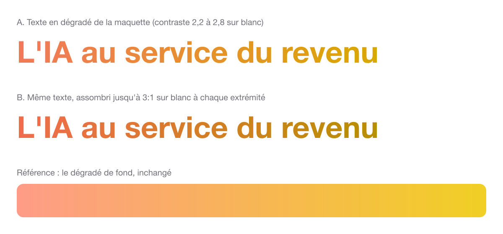

# Refonte du site : sept points à trancher côté Ocobo

**Objet :** obtenir les réponses qu'Ocobo seul peut donner avant la mise en ligne des pages enjeu et de la page équipe.

**De :** Jérôme · **À :** Benjamin · **Usage des réponses :** elles complètent les décisions de cadrage et les tickets de la refonte.

## Contexte

Le cadrage technique de la refonte est fait. Les six pages enjeu deviennent du contenu que chaque expert modifie lui-même. Le design system de la maquette s'applique à tout le site dès la première livraison. Sept points restent ouverts : ils dépendent d'un choix d'Ocobo, d'un tiers ou de l'usage avec vos clients. Aucun ne bloque la première livraison. Chacun bloque la mise en ligne de la page qu'il concerne.

## Comment répondre

Réponse souhaitée avant le [date à fixer], environ 15 minutes. Une réponse partielle ou un « je ne sais pas » nous aide aussi. Signale ce dont tu n'es pas sûr plutôt que de le sauter.

## Équipe et contenu

### Jeanne, Hugo, Domitille et Corentin : qui est expert de quel enjeu ?

_Pourquoi c'est important : la maquette se contredit. `equipe.html` place Jeanne et Hugo sur Sales Experience, Domitille et Corentin sur Revenue Performance. Les pages enjeu font l'inverse. Les textes de contribution suivent `equipe.html`. Chaque personne sera rattachée à un seul enjeu, et sa carte apparaîtra sur cette page seulement._

>

### Qui sera l'expert principal de chacun de ces deux enjeux ?

_Pourquoi c'est important : l'expert principal valide toute modification de sa page enjeu._

>

### Qobra accepte-t-il que nous publiions ses chiffres sur Doctolib et Pennylane ?

_Pourquoi c'est important : la page Sales Compensation affiche « 7 jours → 1 » (Doctolib) et « 3 jours → ½ » (Pennylane), avec la mention « source : Qobra ». Ce sont des chiffres de clients d'un tiers. Sans accord écrit, le bloc partenaire ne sera pas publié._

>

### Sous quelle forme Qobra veut-il apparaître ?

_Par exemple : logo, formulation de la phrase de positionnement, libellé de la source, relecture de leur part avant mise en ligne._

>

## Visuels

### Le texte en dégradé IA assombri est-il encore la marque ?

_Pourquoi c'est important : le dégradé corail vers jaune de la maquette, utilisé en texte sur fond blanc, est trop peu contrasté pour être lu par tous. Nous l'assombrissons jusqu'au seuil d'accessibilité (contraste 3:1). Le jaune tire alors vers l'ocre. Comparaison ci-dessous (police système, pas Bermia). Le dégradé de fond ne change pas, et le texte en dégradé reste réservé aux grands titres._

>

### Quelle nuance de gris identifie Revenue Systems ?

_Pourquoi c'est important : chaque enjeu a une couleur, réutilisée sur ses pastilles, ses cartes et ses experts. La maquette utilise deux gris pour Revenue Systems : #767676 sur `methode.html`, #A1A1AA sur la carte de la home et l'anneau des experts. Nous en garderons un seul._

>

### Le bow tie de la page Revenue Systems doit-il être gris, ou coloré par position dans le cycle ?

_Pourquoi c'est important : `methode.html` le trace en gris. `enjeux-outils.html` le colore par position (mint, jaune, bleu ciel). Par défaut, nous suivrons la règle des autres enjeux : la couleur de l'enjeu._

>

### Faut-il signaler comme fictifs les comptes affichés dans les fenêtres d'agent ?

_Pourquoi c'est important : les démonstrations citent Northwind, Brightlane et Kestrel. Seule la page clients précise qu'ils sont fictifs. Un lecteur pourrait les prendre pour de vrais clients d'Ocobo._

>

## Publication

### Qui relit la traduction anglaise avant la mise en ligne ?

_Pourquoi c'est important : la version anglaise est traduite automatiquement depuis le français. Sans relecteur désigné, elle partira sans relecture humaine._

>

### Employez-vous le mot « jalon » avec vos clients ?

_Pourquoi c'est important : chaque étape du bow tie se termine par un jalon (MQL, SQL, SQO, nouveau client…). Si vos clients disent autrement, nous reprendrons votre mot sur le site._

>

## Autre chose ?

Y a-t-il un point que nous n'avons pas abordé et que nous devrions connaître ?

>
